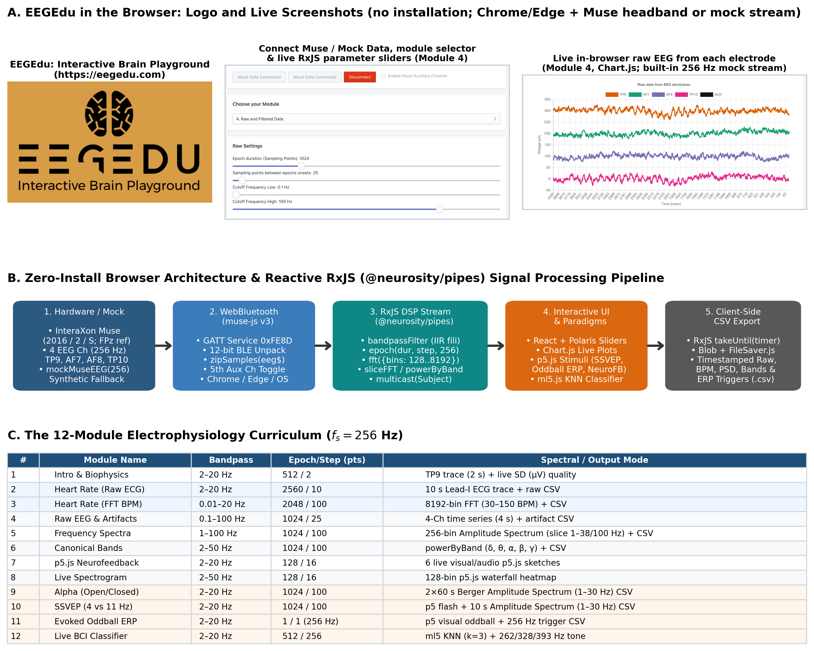
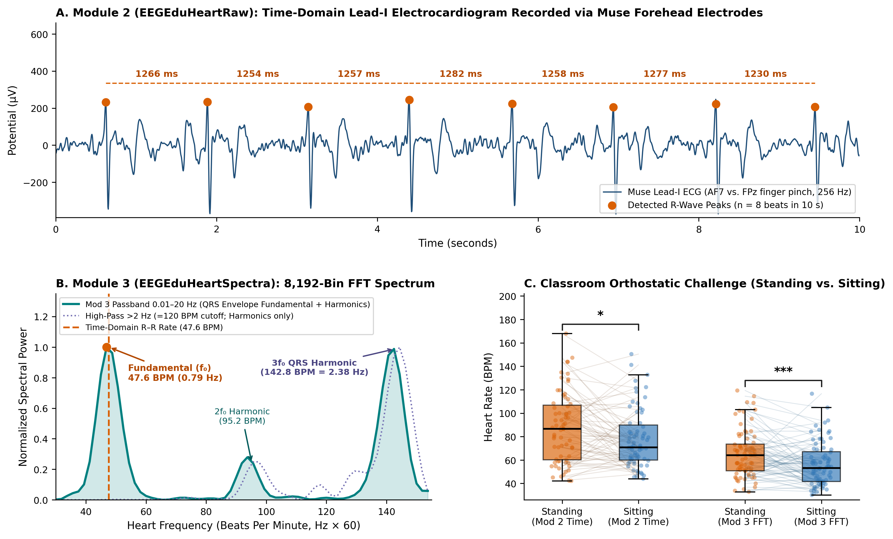
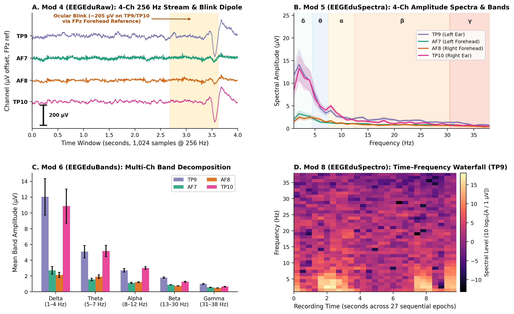
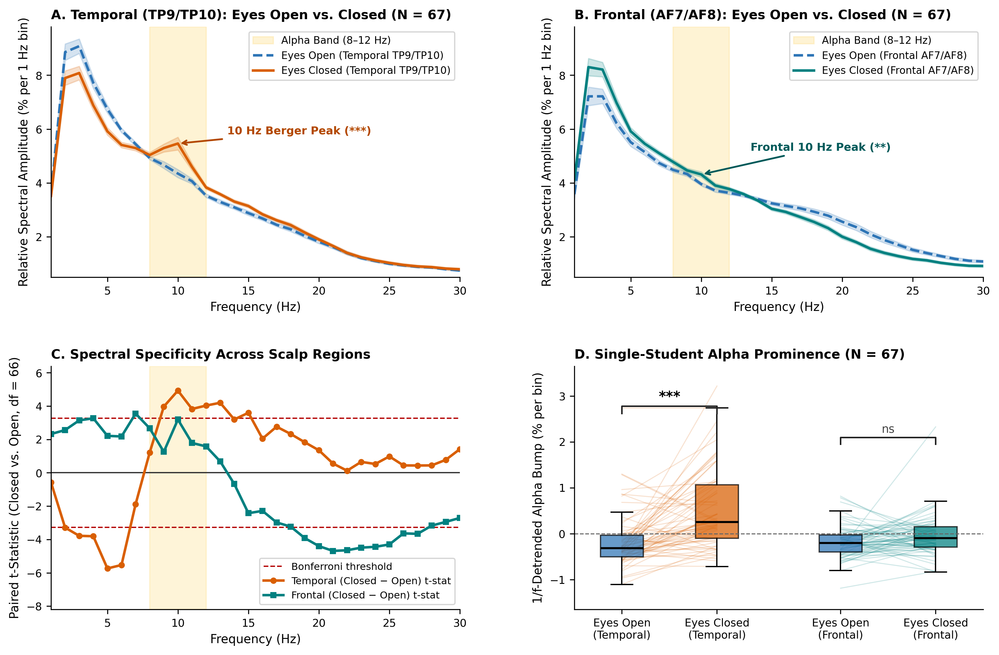
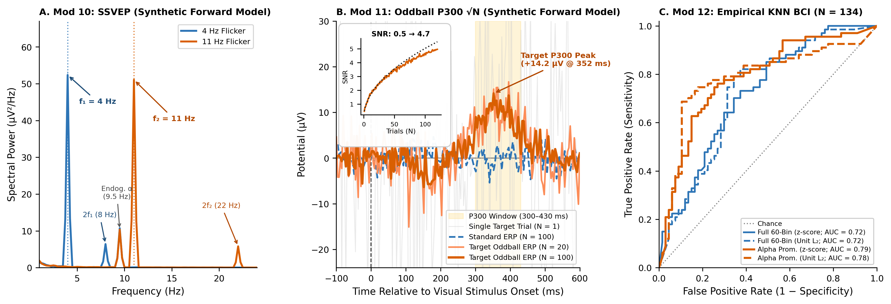

**Article Type:** Original Article — Methodological Developments (*Psychophysiology*)  
**Running Head:** `EEGEDU: BROWSER WEBBLUETOOTH ELECTROPHYSIOLOGY` (46 characters)

# EEGEdu: A Zero-Install, Reactive WebBluetooth Platform for Human Electrophysiology, Time–Frequency Signal Processing, and Brain–Computer Interfaces

**Keyfer P. Mathewson¹², Kory W. Mathewson³⁴, and Kyle E. Mathewson⁵⁶***

¹ Shopify Inc., Ottawa, ON, Canada  
² Goody (OnGoody Inc.), San Francisco, CA, USA  
³ Department of Computing Science, Faculty of Science, University of Alberta, Edmonton, AB, Canada  
⁴ Google DeepMind, Montreal, QC, Canada  
⁵ Department of Psychology, Faculty of Science, University of Alberta, Edmonton, AB, Canada  
⁶ Neuroscience and Mental Health Institute (NMHI), Faculty of Medicine and Dentistry, University of Alberta, Edmonton, AB, Canada  

**ORCID iDs:** Kory W. Mathewson (`https://orcid.org/0000-0002-5688-6221`); Kyle E. Mathewson (`https://orcid.org/0000-0003-4856-3980`)  
**Correspondence:** Dr. Kyle E. Mathewson, Department of Psychology, P-217 Biological Sciences Building, University of Alberta, Edmonton, AB, T6G 2E9, Canada (`kyle.mathewson@ualberta.ca`)  
**Live Platform:** https://eegedu.com  
**Source Code:** https://github.com/kylemath/EEGEdu (MIT License)

---

## Abstract

Deploying hands-on human electroencephalography (EEG) and electrocardiography (ECG) outside specialized laboratories or across large university classrooms remains constrained by amplifier costs, operating-system driver incompatibilities, and complex native streaming software. Here we present **EEGEdu** (`https://eegedu.com`), an open-source, zero-install progressive web application that streams four- and five-channel electrophysiology directly from consumer wireless headbands into any Chromium browser via WebBluetooth and processes neural time series in real time using functional reactive streams (256 Hz via InteraXon Muse, `muse-js`, `RxJS`, and `@neurosity/pipes`). EEGEdu organizes psychophysiological recording and digital signal processing into a 12-module curriculum spanning dry-electrode contact impedance, a finger-pinch cardiac time-to-frequency bridge, multi-channel artifact taxonomy, linear spectral amplitude estimation, canonical frequency band decomposition, closed-loop neurofeedback, live time–frequency spectrograms, steady-state visual evoked potentials (SSVEPs), oddball event-related potentials (ERPs), and in-browser nearest-neighbor brain–computer interface (BCI) classification. Validating EEGEdu across undergraduate laboratory recordings at the University of Alberta ($N = 86$ roster IDs, REB `Pro00050069`) demonstrates significant orthostatic heart-rate increases from sitting to standing in both time-domain peak counting ($t(66) = 2.54, p = 0.0135, d_z = 0.31$; symmetric sensitivity check: $t(74) = 2.14, p = 0.0357, d_z = 0.25$) and zero-padded Fourier spectral tracking ($t(75) = 3.49, p = 8.01 \times 10^{-4}, d_z = 0.40$). Furthermore, structured classroom recordings robustly replicated the Berger alpha reactivity effect across complete four-condition datasets, with eye closure driving larger alpha increases over posterior-temporal than anterior-frontal scalp regions ($N = 67$; temporal: $t(66) = 5.62, p = 4.24 \times 10^{-7}, d_z = 0.69$; frontal: $t(66) = 3.06, p = 0.0032, d_z = 0.37$; Region $\times$ Condition interaction: $t(66) = 2.59, p = 0.0119, d_z = 0.32$), in sharp contrast to an initial unguided 10-second baseline exercise confounded by ocular artifacts ($N = 83, t(82) = -2.82, p = 0.0060$). Finally, flanking-detrended posterior-temporal alpha prominence confirmed narrowband oscillatory synchronization in both linear ($t(66) = 6.20, p = 4.22 \times 10^{-8}, d_z = 0.76$, 80.6% single-subject replication) and scale-invariant log-decibel coordinates ($t(66) = 5.96, p = 1.08 \times 10^{-7}, d_z = 0.73$; interaction $t(66) = 3.03, p = 0.0035$).

**Keywords:** electroencephalography (EEG), electrocardiography (ECG), time–frequency analysis, event-related potentials (ERPs), brain–computer interface (BCI), WebBluetooth

> **Impact Statement (64 words):** Moving human electrophysiology into classrooms and scalable out-of-the-lab settings has been bottlenecked by brittle native Bluetooth drivers and Lab Streaming Layer dependencies. EEGEdu (`https://eegedu.com`) eliminates all local software installation by executing 256 Hz WebBluetooth acquisition, causal Butterworth filtering, Fourier spectral analysis, stimulus presentation, and machine-learning BCI decoding directly inside a standard web browser tab, enabling reliable group-level and single-subject measurement of cardiac and cortical oscillations.

---

## 1. Introduction

Rigorous research and laboratory instruction in human psychophysiology require recording, manipulating, and interpreting live bioelectrical time series (Marzullo & Gage, 2012; Segawa, 2019; Kuziek et al., 2017; Mathewson et al., 2017; Keil et al., 2022). Historically, direct hands-on access to human electroencephalography (EEG) and electrocardiography (ECG) was restricted to specialized research laboratories because clinical-grade amplifier systems cost tens of thousands of dollars per station and require dedicated Faraday shielding, conductive gels, and technician oversight (Luck, 2014; Mathewson et al., 2017). Over the past decade, low-cost open-source bioamplifiers (Marzullo & Gage, 2012), single-board portable acquisition computers (Kuziek et al., 2017, 2018), and validated consumer wireless EEG headsets have reduced hardware costs by two orders of magnitude and enabled reliable measurement of event-related potentials (ERPs), spectral oscillations, mobile cognition, and classroom brain-to-brain synchrony in naturalistic environments (such as the InteraXon Muse, which samples four dry scalp sensors and a micro-USB auxiliary channel at 256 Hz against a mid-forehead reference; Debener et al., 2012; Krigolson et al., 2017; Scanlon et al., 2017; Dikker et al., 2017; Cannard et al., 2021).



*Figure 1: EEGEdu Overview: Logo, Live Browser Screenshots, Reactive Architecture, and 12-Module Electrophysiology Curriculum. (A) The EEGEdu logo ("Interactive Brain Playground") alongside two unedited screenshots of the deployed web application at https://eegedu.com captured in Google Chrome using the built-in 256 Hz synthetic stream (`mockMuseEEG(256)`): the Shopify Polaris control panel showing the WebBluetooth and Mock Data connection buttons, the module selector, and live reactive parameter sliders (Module 4; epoch duration, step interval, and bandpass cutoffs), and the live Chart.js raw voltage traces of each electrode (Module 4; `TP9`, `AF7`, `AF8`, `TP10`, `AUX`). (B) Client-side reactive architecture: 256 Hz EEG packets from an InteraXon Muse headband (or the mock stream) are ingested via the browser's native WebBluetooth GATT API (`muse-js`), zipped into synchronized multi-channel frames, processed through composable `RxJS` and `@neurosity/pipes` operators (`bandpassFilter`, `epoch`, `fft`, `sliceFFT`, `powerByBand`), rendered at 60 FPS via React/Polaris and Chart.js/p5.js, and exported to client-side CSV files. (C) Signal-processing parameters across all 12 instructional modules (sampling rate $f_s = 256\text{ Hz}$, epoch duration and step interval in samples).*

However, democratizing hardware solved only half of the deployment bottleneck. Whereas behavioral psychology laboratories have widely transitioned to zero-install browser frameworks (e.g., `jsPsych`; de Leeuw, 2015), electrophysiology recording and instruction still rely heavily on native desktop pipelines. In multi-participant field studies or university laboratories of 30 to 100 students using personal laptops across diverse operating systems (Windows, macOS, Linux, and ChromeOS), software installation remains a persistent point of failure. Native Bluetooth Low Energy (BLE) streaming utilities and custom desktop Lab Streaming Layer (LSL) scripts frequently fail due to operating-system permission sandboxes, binary dependency conflicts, institutional firewall blocks on local multicast sockets, or unsupported Chromebook architectures (`BlueMuse`, `muselsl`, EEGLAB, and MNE-Python; Delorme & Makeig, 2004; Gramfort et al., 2013). Consequently, substantial experimental and instructional time is routinely lost to troubleshooting software environments rather than studying neural oscillations or digital signal processing (DSP).

Even when streaming succeeds, researchers and students entering electrophysiology face a second methodological hurdle: the conceptual and analytical leap from time-domain voltage fluctuations over milliseconds to frequency-domain spectral representations across hertz (Keil et al., 2022). In spontaneous scalp EEG, multiple narrowband cortical rhythms—spanning delta (1–4 Hz), theta (4–8 Hz), alpha (8–12 Hz), and beta (13–30 Hz)—are superimposed atop a broadband aperiodic background that decays with frequency ($1/f^{\chi}$; Donoghue et al., 2020) and are intermittently contaminated by large ocular and muscle artifacts (100–800 $\mu\text{V}$). Applying a Fast Fourier Transform (FFT) directly to noisy multi-component EEG without transparent control over windowing, filter roll-off, and zero-padding often obscures the physical meaning of frequency decomposition (Keil et al., 2022).

To overcome both the software deployment barrier and the analytical gap between time and frequency domains, we developed **EEGEdu** (`https://eegedu.com`), an open-source, zero-install progressive web application built on WebBluetooth, React, and functional reactive streams (`RxJS` and `@neurosity/pipes`). By executing all Bluetooth communication, digital filtering, epoching, spectral estimation, stimulus presentation, machine-learning classification, and spreadsheet logging directly inside the browser tab, EEGEdu eliminates all driver and script installations. Furthermore, EEGEdu introduces a novel cardiac-to-neural methodological bridge before users analyze multi-component brain oscillations (Modules 2 and 3): users pinch the headset's left frontal and central forehead reference electrodes between their fingers to transform the headband into a single-lead electrocardiogram (Lead-I ECG across `AF7` and `FPz`). Because the human heartbeat is a high-amplitude, strictly periodic signal around 1 Hz that can be simultaneously felt at the radial pulse, counting heartbeat peaks in a 10-second time window (Module 2) and immediately observing that exact same rate appear as a fundamental harmonic peak in a beats-per-minute Fourier spectrum (Module 3) provides a direct physical anchor for the Fourier transform before transitioning to multi-channel cortical EEG (Modules 4–12).

---

## 2. Method

### 2.1 Participants, Classroom Recording Protocol, and Ethics

To evaluate EEGEdu under authentic multi-user conditions, we analyzed de-identified empirical recordings collected by undergraduate neuroscience and psychology students at the University of Alberta ($N = 86$ roster IDs across single-session and multi-week laboratory sections; Research Ethics Board Protocol `Pro00050069`). In laboratory sections of 30 to 80 students working in pairs or small teams sharing 15 to 25 wireless headbands, participants either completed the core introductory and alpha modules within a single 3-hour laboratory period (Modules 1–5 and 9) or progressed through all 12 modules across a multi-week curriculum. Operating wireless electrophysiology at this scale inside an unshielded lecture hall requires addressing specific Bluetooth Low Energy (BLE) radio and logistical constraints. The 2.4 GHz BLE protocol reserves only three physical advertising channels (Channels 37, 38, and 39) for peripheral discovery; powering on 20 headbands simultaneously can flood these advertising channels and cause connection timeouts in the browser. To eliminate discovery collisions, each headband was labeled with its factory four-character hexadecimal suffix (`Muse-XXXX`), which appears directly inside Google Chrome's WebBluetooth pairing chooser, and student pairs paired their headbands in staggered 30-second rows. Once a GATT connection is established, the active 256 Hz data stream shifts to the remaining 37 adaptive frequency-hopping data channels, consuming negligible bandwidth ($\sim 4\text{ kbps}$ per headset) with zero cross-talk across adjacent lab stations.

Between lab partners, a structured rotation procedure prevents common operational failures: students click `Disconnect` in the browser or power down the headband so the peripheral resumes BLE advertising rather than remaining bonded to the host operating-system Bluetooth daemon. Headband hygiene is maintained between users using alcohol-free sanitizing wipes; avoiding ethanol prevents embrittlement and degradation of the conductive silicone ear tabs and forehead electrodes. The internal lithium-ion polymer batteries provide 4 to 5 hours of continuous streaming, easily spanning consecutive 3-hour lab sections without recharging. Because dry sensors behind the pinna require consistent skin contact (`TP9/TP10`; Mathewson et al., 2017), the introductory module trained participants to part hair, lightly dampen the skin or conductive silicone tab with water, and verify that rolling voltage standard deviation dropped below 25 $\mu\text{V}$ before commencing experimental recordings; participants who preferred not to wear a headband participated as the browser operator, data analyst, or via the built-in 256 Hz synthetic EEG stream (`mockMuseEEG(256)`). On iOS and iPadOS where WebKit omits the WebBluetooth API, students use the third-party Bluefy browser for live interactive module visualization, while desktop and Chromebook Chromium browsers provide native `FileSaver.js` CSV export for quantitative assignments.

Because all Bluetooth acquisition, causal filtering, Fourier transformation, visual stimulation, and machine-learning classification execute strictly within the local client-side browser sandbox, zero raw bioelectrical time series, spectral arrays, or personal identifiers are ever transmitted to an external server. This entirely local execution architecture protects student privacy and simplifies institutional compliance under educational and data-protection regulations (such as FERPA, GDPR, and institutional ethics guidelines).

### 2.2 WebBluetooth Hardware Ingestion and Reactive DSP Architecture

EEGEdu is architected as a client-side React single-page application styled with Shopify Polaris interface components and deployed via Firebase Hosting with offline caching (Figure 1A,B). Hardware ingestion uses the browser's native W3C WebBluetooth API to connect directly to consumer Muse headbands across Windows, macOS, Linux, Android, and ChromeOS (`muse-js` v3.0 over GATT service `0xFE8D` on Muse 2016, Muse 2, and Muse S; on iOS/iPadOS where WebKit omits WebBluetooth, users connect via the Bluefy browser or use the synthetic stream).

On the Muse hardware, four active dry electrodes—left and right temporo-mastoid sensors behind the ears and left and right anterior-frontal sensors on the forehead—plus an optional fifth auxiliary channel are differentially amplified against the central forehead reference with driven right-leg common-mode feedback (`TP9`, `AF7`, `AF8`, `TP10`, and micro-USB `AUX` referenced to `FPz`). Each Bluetooth notification packet across GATT characteristics `273e0003`–`273e0007` packs 12 unsigned 12-bit samples from a single electrode at a nominal sampling rate of 256 Hz ($0.48828125\ \mu\text{V/LSB}$ resolution), representing a packet duration of $T_{\text{packet}} = 12 / 256\text{ Hz} = 46.875\text{ ms}$ ($f_{\text{packet}} = 21.33\text{ Hz}$). An arrival-order buffering operator zips incoming single-electrode packets into synchronized multi-channel frames at 256 Hz once all active electrodes have reported (`zipSamples(museClient.eegReadings$)`, emitting 4- or 5-channel vectors). To guarantee full accessibility for remote learners or large classrooms sharing headsets, every module includes a one-click toggle to a synthetic 256 Hz generator that emits 12-sample packets every 46.875 ms containing pink noise plus amplitude-modulated 10 Hz alpha bursts through the exact same reactive pipeline (`Use Mock Data` invoking `mockMuseEEG(256)`).

Electrode placement creates two distinct differential derivations with contrasting biophysical properties. The anterior forehead derivations (`AF7–FPz` and `AF8–FPz`) feature an ultra-short inter-electrode spacing of roughly 3 to 4 cm; because both electrodes lie in close proximity over the frontal bone, broad volume-conducted potentials—such as vertical corneo-retinal blink dipoles—project nearly equally onto active and reference inputs and are largely suppressed by common-mode rejection, whereas local horizontal saccadic potentials and facial electromyographic (EMG) signals survive. Conversely, the posterior temporo-mastoid derivations (`TP9–FPz` and `TP10–FPz`) span an extended fronto-mastoid distance of 14 to 16 cm; because the active sensor sits behind the ear far from the eye, positive forehead blink dipoles entering the inverting `FPz` reference produce large, inverted positive-going excursions on `TP9` and `TP10`. Crucially, the right-ear temporo-mastoid contact also houses the Driven Right Leg (DRL) and Common Mode Sense (CMS) circuitry; firm skin contact at `TP10` is therefore essential to actively cancel 60 Hz common-mode mains interference across all four recording channels.

Real-time digital signal processing is implemented declaratively by chaining reactive observables with modular signal-processing operators (`RxJS` and `@neurosity/pipes` v3.0.2, backed by `fili` v2.0.1 and `dsp.js` v1.0.1):

```javascript
window.source.pipe(
  bandpassFilter({
    cutoffFrequencies: [Settings.cutOffLow, Settings.cutOffHigh],
    nbChannels: window.nchans, samplingRate: Settings.srate
  }),
  epoch({ duration: Settings.duration, interval: Settings.interval, samplingRate: Settings.srate }),
  fft({ bins: Settings.bins }),
  sliceFFT([Settings.sliceFFTLow, Settings.sliceFFTHigh]),
  catchError(err => console.log(err))
);
```

Each stage in this reactive pipeline performs a mathematically explicit transformation on the incoming bioelectrical stream. Prior to windowing, the bandpass operator passes each continuous channel sample-by-sample through a digital filter cascade at 256 Hz (`bandpassFilter`). In `@neurosity/pipes`, passing parameter `order: 2` to `fili`'s `CalcCascades` executes an internal loop that cascades two 2nd-order biquad stages per cutoff, generating a causal 4th-order Butterworth high-pass section ($-24\text{ dB/octave}$ roll-off) in series with a causal 4th-order Butterworth low-pass section ($-24\text{ dB/octave}$ roll-off)—an 8-pole bandpass cascade with causal nonlinear phase response. When the auxiliary fifth channel is disabled, the active channel count is restricted to four so that undefined values from the unattached sensor never enter the filter registers (`window.nchans = 4`). Filtering the continuous stream before segmentation avoids edge transients on individual sliding windows. Conversely, whenever a user adjusts a filter cutoff slider in the interface, the application immediately tears down the active stream subscription and initializes fresh filter registers (`resetPipeSetup`), producing a visible settling transient whose duration scales inversely with the high-pass cutoff ($\tau \approx 1 / [\pi f_{\text{low}}]$: roughly 0.16 s for a 2 Hz cutoff, compared to 10–20 s for a 0.01 Hz cutoff in Module 3), which instructors actively use to demonstrate filter impulse responses and settling time.

Following continuous filtering, the epoch operator segments the stream into sliding rectangular windows parameterized by window duration and step interval in samples at 256 Hz (`epoch`; Figure 1C). Downstream, the Fourier operator extracts the trailing $N_{\text{FFT}}$ samples from each epoch buffer and executes a radix-2 Fast Fourier Transform (`fft` via `dsp.js` `calculateSpectrum`). For a discrete window $x_c[n]$ ($n = 0, \dots, N_{\text{FFT}}-1$), the discrete Fourier transform and one-sided linear spectral amplitude are defined by:

$$X_c[k] = \sum_{n=0}^{N_{\text{FFT}}-1} x_c[n] \, e^{-j 2\pi k n / N_{\text{FFT}}}, \qquad \hat{A}_c[k] = \frac{2}{N_{\text{FFT}}} \left|X_c[k]\right| \quad (\mu\text{V}) \tag{1}$$

across positive frequency bins ($0 < k < N_{\text{FFT}}/2$, bin spacing $\Delta f = f_s / N_{\text{FFT}}$). Although the underlying JavaScript library labels its output array `psd`, the routine actually computes the one-sided linear spectral amplitude in microvolts (representing the peak amplitude of each sinusoidal component rather than squared power density). This linear spectral amplitude is related to the conventional one-sided periodogram power spectral density by a constant scaling factor:

$$\hat{S}_c[k] = \frac{N_{\text{FFT}}}{2 f_s} \hat{A}_c[k]^2 = \frac{2}{N_{\text{FFT}} f_s} \left|X_c[k]\right|^2 \quad (\mu\text{V}^2/\text{Hz}). \tag{2}$$

When the physical window contains fewer samples than $N_{\text{FFT}}$ ($N_{\text{win}} < N_{\text{FFT}}$, as in Module 3 where zero-padding expands 2,048 samples to 8,192 bins), `dsp.js` divides the unwindowed sum by $N_{\text{FFT}}$, scaling linear amplitudes by $N_{\text{win}} / N_{\text{FFT}} = 0.25$.

Crucially, because `@neurosity/pipes`'s `fft` operator extracts the trailing `bins` samples whenever the epoch duration exceeds the number of bins (`safeSamples.slice(safeSamples.length - bins)`), the effective Fourier aperture is governed by `bins` rather than `duration`. In Module 12 (`duration: 512, interval: 256, bins: 256`), the operator slices and transforms the trailing 256 samples, yielding a 1.0 s aperture at $\Delta f = 1.0\text{ Hz}$ that steps every 1.0 s with 0% overlap. In Modules 5, 6, 8, 9, and 10, the buffer holds 1,024 samples (4.0 s) advancing every 100 samples (0.3906 s), and the 256-bin transform slices the trailing 256 samples (1.0 s aperture, $\Delta f = 1.0\text{ Hz}$). Because the step interval is 100 samples, consecutive 256-sample Fourier windows share 156 samples, maintaining an exact 60.9% overlap across consecutive 1.0 s spectral estimates ($156/256 = 60.9375\%$). Increasing the UI `Epoch duration` slider in these modules simply adds buffer fill delay without changing the 1.0 s FFT aperture or 1.0 Hz bin spacing unless `bins` is concurrently coupled to `duration`. Conversely, in Module 3, where an 8.0 s window of 2,048 samples is zero-padded to 8,192 bins, zero-padding interpolates the spectrum to a fine bin spacing of 0.03125 Hz (1.875 BPM) without altering the true physical window resolution ($1/T = 0.125\text{ Hz} = 7.5\text{ BPM}$). Because rectangular windows exhibit sidelobe leakage ($-13\text{ dB}$ first sidelobe, $-6\text{ dB/octave}$ roll-off), continuous pre-epoch high-pass filtering is essential to suppress DC offsets and slow baseline drift before the transform (Keil et al., 2022). Downstream modules either restrict this spectrum to a target frequency range (`sliceFFT`) or average spectral amplitude across canonical frequency bands (`powerByBand`). In `@neurosity/pipes`, canonical band bounds are defined with inclusive floating-point limits ($[0.1, 4]$, $[4, 7.5]$, $[7.5, 12.5]$, $[12.5, 30]$, and $[30, 100]$ Hz, which on 1 Hz integer bins shares boundary bins at 4 Hz between delta and theta, and at 30 Hz between beta and gamma); in our offline cohort analyses (Figure 3C), we evaluate strictly disjoint integer partitions: delta (1–4 Hz), theta (5–7 Hz), alpha (8–12 Hz), beta (13–30 Hz), and gamma (31–38 Hz).

### 2.3 The 12-Module Electrophysiology Protocol

EEGEdu organizes instruction into 12 progressive modules that guide users from foundational electrode biophysics to closed-loop brain–computer interfaces (Figure 1A–C). Every module integrates a concise theoretical tutorial, a real-time visualization canvas (`Chart.js` or `p5.js`), interactive signal-processing sliders in the exploratory modules (exposed in Modules 4–10; locked in Modules 1–3 and 11–12 via `PageSwitcher.js` to preserve standardized classroom timing), and client-side CSV spreadsheet export in the eight quantitative recording modules (single-snapshot export via `take(1)` in Module 2; timed multi-epoch logging via `takeUntil(timer$)` and `FileSaver.js` in Modules 3–6 and 9–11).

**Module 1: Dry-electrode contact impedance and signal quality.** The introductory module streams a 2 s window from the left temporo-mastoid sensor while computing rolling voltage standard deviation on every emission to dynamically shift the trace color from bright red during noisy or floating contact to calm teal once fluctuations drop below the 15–25 $\mu\text{V}$ target range (`EEGEduIntro`; `TP9`, 2–20 Hz bandpass, 512-sample window, 2-sample step). Restricting this module's filter passband to 2–20 Hz isolates mechanical contact stability from 60 Hz mains hum, ensuring students learn to part hair and seat the conductive tab firmly against the mastoid skin before starting experimental trials.

**Module 2: Time-domain Lead-I electrocardiogram.** Students remove the headset and pinch the left frontal sensor (`AF7`) with their left thumb and forefinger while holding the central forehead reference (`FPz`) with their right fingers to record a 10 s Lead-I electrocardiogram across the arms (`EEGEduHeartRaw`; 2–20 Hz bandpass, 2,560 samples, 10-sample step). Because the right-ear temporo-mastoid sensor (`TP10`) floats in air during this pinch, the DRL common-mode suppression circuit is open; pre-epoch 20 Hz low-pass filtering eliminates 60 Hz mains hum, while students export the waveform as a two-row spreadsheet for manual R-wave peak counting.

**Module 3: Frequency-domain cardiac spectrum and harmonic analysis.** Maintaining the same finger-pinch grip, EEGEdu pipes an 8 s sliding window through an ultra-low high-pass filter and a zero-padded 8,192-bin FFT plotted directly in beats per minute from 30 to 150 BPM, logging the dominant spectral peak every 0.39 s across a 10 s recording so students can average their spectral heart rate (`EEGEduHeartSpectra`; 0.01–20 Hz bandpass, 2,048-sample window, 100-sample step, $0.5\text{--}2.5\text{ Hz} \times 60$). In `PageSwitcher.js`, parameter sliders are hidden by default to enforce standardized classroom acquisition; instructors can expose sliders via `renderSliders` or use Module 4 to illustrate the $\tau \approx 15.9\text{ s}$ settling transient of the 0.01 Hz high-pass filter.

**Module 4: Multi-channel EEG and artifact taxonomy.** Returning the headband to the scalp, this module displays four-channel broadband EEG so students can systematically generate, inspect, and export ocular blinks, horizontal eye movements, jaw clenches, brow tension, and AC line noise (`EEGEduRaw`; 0.1–100 Hz bandpass, 1,024-sample window, 25-sample step; Figure 3A).

**Module 5: Multi-channel Fourier amplitude spectra.** This module introduces multi-channel FFT amplitude spectra across 1 Hz integer bins, enabling students to observe $1/f$ aperiodic decay alongside narrowband oscillations and adjust the frequency slice slider to exclude 60 Hz mains interference before exporting multi-epoch spectral tables (`EEGEduSpectra`; 1–100 Hz bandpass, 1,024-sample window, 100-sample step, 256 bins sliced to 1–38 Hz in class).

**Module 6: Canonical frequency band decomposition.** Averaging integer spectral bins across delta, theta, alpha, beta, and gamma bands, this module renders real-time four-channel bar charts and logs multi-epoch band amplitudes for classroom baseline comparisons (`EEGEduBands`; 2–50 Hz bandpass, 1,024-sample window, 100-sample step, 256 bins via `powerByBand`).

**Module 7: Closed-loop neurofeedback.** Routing real-time left-frontal band amplitudes into six selectable audiovisual environments, this module allows students to experience closed-loop neurofeedback through 3D frequency bars, harmonic chord sonifications, a 3D cube whose rotation tracks alpha and whose size tracks delta, 2D and 3D Reynolds flocking boids that steer toward spatial coordinates set by alpha, beta, and theta amplitudes, and an alpha/beta drawing canvas (`EEGEduAnimate`; `AF7`, 2–20 Hz bandpass, 128-sample window, 16-sample step, 256 bins).

**Module 8: Live time–frequency spectrogram.** Rendering a high-cadence rolling time–frequency waterfall heatmap from the left frontal sensor, this module provides an interactive demonstration of the Gabor time–frequency uncertainty trade-off as users manipulate window duration (`EEGEduSpectro`; `AF7`, 2–50 Hz bandpass, 128-sample / 0.5 s window, 16-sample / 62.5 ms step, 128 bins, $\Delta f = 2.0\text{ Hz}$).

**Module 9: Classroom Berger alpha experiment.** Automating a standardized Berger alpha protocol, this module guides participants through counterbalanced 60 s Eyes Open (visual fixation cross) and 60 s Eyes Closed recordings after a 2 s settling delay, exporting multi-epoch four-channel spectra from 1 to 30 Hz that students average across time and homologous left/right electrode pairs in Google Sheets (`EEGEduAlpha`; 2–20 Hz bandpass, 1,024-sample window, 100-sample step, 256 bins).

**Module 10: Steady-state visual evoked potentials.** Implementing visual frequency tagging, this module flashes a full-field circle with a central fixation cross at 4 Hz or 11 Hz across 10 s spectral recordings with optional fifth-channel occipital sensor support (`EEGEduSsvep`; 300 px circle, single-frame 16.7 ms black flash, 2–20 Hz bandpass, 1,024-sample window, 100-sample step, 256 bins). In `sketchFlashFast.js`, advancing flash timestamps via a phase-locked accumulator (`startTime += delay`) eliminates cumulative timing drift at 11.000 Hz despite 60 Hz frame quantization.

**Module 11: Visual oddball event-related potentials.** Presenting a randomized visual oddball sequence of frequent blue standard circles and rare red target circles, this module streams continuous 256 Hz EEG stamped with stimulus onset triggers and behavioral reaction-time markers for offline trial epoching and ERP averaging (`EEGEduEvoked`; 25% targets vs. 75% standards, single-frame 16.7 ms flash, 500–1,500 ms jittered inter-stimulus interval, sample-by-sample `epoch(1, 1)` logging). In `EEGEduEvoked.js`, `zipSamples` unrolls arriving 12-sample BLE packets synchronously while `saveToCSV` stamps `Date.now()` and latches `window.marker` (10 or 20) to sample 0 of the 12-sample burst; offline epoching indexes time by sample row count ($\Delta t = 1/256\text{ s} = 3.90625\text{ ms/row}$) relative to the marker row. Sliders are locked in the UI to prevent students from inadvertently applying severe high-pass filtering ($>0.5\text{ Hz}$) that distorts slow ERP components (Tanner et al., 2015; Luck, 2014).

**Module 12: In-browser machine-learning BCI.** The capstone module trains a live $k$-nearest neighbors classifier on 2 s left-temporal spectral vectors across three user-recorded mental or physiological states, normalizing each 30-bin feature vector to unit length to evaluate cosine similarity and mapping real-time class predictions and confidence scores into a C-major triad synthesizer (`EEGEduPredict`; `ml5.KNNClassifier` with $k = 3$ and unit-$L_2$ normalization on `TP9` 1–30 Hz spectra, driving a `p5.Oscillator` at 262, 327.5, and 393 Hz). This live in-browser calibration operates across three within-subject classes (Class A: Eyes Closed, Class B: Eyes Open, and Class C: Blinking, where Class C exploits the large $\sim 205\ \mu\text{V}$ blink dipole on `TP9`), distinguishing it from our offline cross-subject binary classification benchmarks.

---

## 3. Results

Our empirical and analytical evaluation of EEGEdu spans three distinct validation tiers across the 12-module curriculum: (1) multi-participant classroom cohort benchmarks ($N = 59\text{--}83$ undergraduate students completing Modules 2, 3, 6, 9, and 12 in unshielded instructional labs); (2) single-session empirical demonstration recordings (verifying Lead-I ECG waveforms in Modules 2 and 3, four-channel ocular and muscular artifacts in Module 4, and $N = 27$ consecutive 1.0 s Fourier spectra and time–frequency spectrograms in Modules 5, 6, and 8); and (3) synthetic Monte Carlo forward models parameterized to empirical Muse noise levels for the advanced evoked potential paradigms in Modules 10 and 11, where full classroom acquisition is constrained by lab duration and electrode montages.



*Figure 2: Empirical Validation of the Cardiac-to-Neural Bridge (Modules 2 and 3). (A) Empirical 10-second Lead-I ECG trace ($f_s = 256\text{ Hz}$, 2,560 samples from `heart_raw.xlsx`) recorded via left-frontal to mid-forehead finger pinch in Module 2 (`AF7`–`FPz`), resolving 8 R-wave peaks (mean R–R $= 1260.6 \pm 17.1\text{ ms}$, resting heart rate $= 47.60\text{ BPM}$). (B) Corresponding 8,192-bin Hann-windowed FFT spectrum plotted in BPM ($\text{Hz}\times 60$), contrasting the Module 2 high-pass filtered spectrum ($>2.0\text{ Hz} = 120\text{ BPM}$ cutoff, purple dotted curve, which attenuates the sub-1 Hz fundamental and leaves higher harmonics) against the QRS envelope-demodulated spectrum reconstructing Module 3's $0.01\text{--}20\text{ Hz}$ passband (solid teal curve), which recovers the true cardiac fundamental ($f_0 = 0.793\text{ Hz} = 47.6\text{ BPM}$) alongside its QRS harmonic series ($2f_0 = 95.2\text{ BPM}$, $3f_0 = 142.8\text{ BPM}$). (C) Classroom orthostatic posture challenge (`alpha_single.xlsx`) with paired single-student trajectories demonstrating significant heart-rate elevation during Standing vs. Sitting in both Module 2 time-domain peak counting ($N = 67$, Standing: $87.57 \pm 29.80\text{ BPM}$ vs. Sitting: $77.85 \pm 25.18\text{ BPM}$, $t(66) = 2.54, p = 0.0135, d_z = 0.31$, Wilcoxon $p = 0.0205$; symmetric $[30, 200]\text{ BPM}$ check: $N = 75, t(74) = 2.14, p = 0.0357, d_z = 0.25$) and Module 3 spectral peak estimation ($N = 76$, Standing: $65.25 \pm 20.11\text{ BPM}$ vs. Sitting: $56.43 \pm 18.60\text{ BPM}$, $t(75) = 3.49, p = 8.01 \times 10^{-4}, d_z = 0.40$, Wilcoxon $p = 5.33 \times 10^{-4}$), with concordant group-level orthostatic $\Delta\text{HR}$ across the $N = 59$ students completing all four conditions ($+9.59 \pm 31.30$ vs. $+9.75 \pm 21.85\text{ BPM}$, paired $t(58) = -0.03, p = 0.974, d_z = 0.00$). Significance brackets: $^*p < 0.05$, $^{***}p < 0.001$.*

### 3.1 Modules 2 & 3: The Lead-I ECG Time-to-Frequency Bridge

When participants pinch the left frontal sensor with their left fingers while holding the central forehead reference with their right fingers, the differential amplifier measures the transthoracic Lead-I cardiac dipole across the arms (`AF7` vs. `FPz`, $V_{\text{LA}} - V_{\text{RA}}$). Because the right-ear temporo-mastoid electrode (`TP10`) is left floating in air during this two-finger pinch, the hardware driven right-leg (DRL) common-mode feedback loop is disengaged, leaving the instrumentation amplifier dependent on common-mode rejection across mismatched dry sensor materials (`AF7` silver ink vs. `FPz` conductive silicone); consequently, pre-epoch low-pass filtering at 20 Hz is essential to suppress 60 Hz mains interference, though touching a second finger of the right hand to `TP10` can actively re-engage the DRL circuit. Because ventricular depolarization generates a half- to one-millivolt QRS complex that is over an order of magnitude larger than scalp EEG, a 10-second time-domain recording in Module 2 resolves unmistakable heartbeat peaks with a regular inter-beat interval corresponding to a resting bradycardic heart rate (Figure 2A; 8 R-wave peaks in `heart_raw.xlsx`, mean R–R $= 1260.6 \pm 17.1\text{ ms}$, heart rate $= 47.60\text{ BPM}$, fundamental frequency $f_0 = 0.793\text{ Hz}$).

Transitioning from Module 2 to Module 3 provides an immediate physical demonstration of digital filter design and harmonic analysis (Figure 2B). Module 2 applies a 2–20 Hz bandpass filter to suppress slow baseline wander during finger movement; however, because a 2.0 Hz high-pass cutoff equals 120 BPM, it attenuates the true sub-1 Hz cardiac fundamental and leaves only higher-frequency overtones in the raw linear spectrum ($f_0 = 0.793\text{ Hz} = 47.6\text{ BPM}$ attenuated; second harmonic $2f_0 = 95.2\text{ BPM}$ and third harmonic $3f_0 = 142.8\text{ BPM} = 2.38\text{ Hz}$ preserved). Biophysically, the third harmonic is prominent even in unfiltered recordings because the ventricular QRS complex is an asymmetric, triphasic impulse train whose Fourier decomposition distributes substantial energy across 2–15 Hz. To reconstruct the cardiac fundamental from Module 2's bandpass-filtered waveform, Figure 2B applies full-wave QRS envelope demodulation ($\text{qrs\_env} = |x_{\text{ECG}}|$) followed by Hann-windowed spectral estimation, recovering the exact $f_0 = 47.60\text{ BPM}$ fundamental alongside its harmonic series. In Module 3, opening the high-pass cutoff to 0.01 Hz while zero-padding the 8.0 s window to 8,192 bins restores the true fundamental peak directly in the live browser and illustrates how zero-padding interpolates a smooth spectral curve without changing the underlying physical window resolution ($\Delta f = 0.03125\text{ Hz} = 1.875\text{ BPM}$ vs. $1/T = 0.125\text{ Hz} = 7.5\text{ BPM}$; Figure 2B).

In classroom deployment, undergraduate students performed a paired orthostatic posture challenge comparing Standing versus Sitting across both cardiac modules (Figure 2C; Table 1; 86 roster IDs in `alpha_single.xlsx`, pre-screened from `heart_spectra_1.xlsx`). In Module 2, student data entry exhibited a two-stage error distribution: an initial screening of `heart_spectra_1.xlsx` identified 11 gross spreadsheet formula and noise-threshold errors (rows where students placed voltage peak thresholds within the baseline noise floor or inverted timestamp subtraction formulas, yielding non-physiological estimates such as 765–7,272 BPM, 0.003 BPM, or negative rates, which were blanked to leave $N = 75$ numerical pairs in `alpha_single.xlsx`); subsequently, applying the standard physiological filter of 40–200 BPM removed eight missed-beat rows (IDs 110, 123, 130, 135, 149, 163, 164, and 184; 31.74–38.87 BPM caused by setting detection thresholds too high, missing 2–3 R-waves in the 10 s window) to yield $N = 67$ valid pairs (89.3% retention). Within this quality-controlled cohort, heart rate increased significantly from sitting to standing (Sitting: $77.85 \pm 25.18\text{ BPM}$ vs. Standing: $87.57 \pm 29.80\text{ BPM}$, mean increase $+9.72\text{ BPM}$, $95\%\text{ CI } [+2.08, +17.37]\text{ BPM}$; paired $t(66) = 2.54, p = 0.0135, d_z = 0.31$, Wilcoxon $p = 0.0205$). To verify that this orthostatic response did not depend on the 40 BPM cutoff, a symmetric sensitivity check adopting the 30–200 BPM passband used in Module 3 retained all submissions without exclusion and confirmed the significant heart-rate increase ($N = 75/75 = 100\%$; Sitting: $75.27 \pm 26.79\text{ BPM}$ vs. Standing: $83.32 \pm 31.01\text{ BPM}$, mean increase $+8.05\text{ BPM}$, $95\%\text{ CI } [+0.55, +15.55]\text{ BPM}$; paired $t(74) = 2.14, p = 0.0357, d_z = 0.25$, Wilcoxon $p = 0.0269$; Table 1). In Module 3, where EEGEdu's automated FFT tracker identified the dominant spectral peak across sliding windows, 100% of submissions fell within physiological bounds without any manual threshold adjustments ($N = 76/76$; Sitting: $56.43 \pm 18.60\text{ BPM}$ vs. Standing: $65.25 \pm 20.11\text{ BPM}$, mean increase $+8.83\text{ BPM}$, $95\%\text{ CI } [+3.80, +13.86]\text{ BPM}$; paired $t(75) = 3.49, p = 8.01 \times 10^{-4}, d_z = 0.40$, Wilcoxon $p = 5.33 \times 10^{-4}$).

Comparing Module 2 and Module 3 reveals key trade-offs between time-domain and frequency-domain estimators. Automated spectral tracking reduced within-condition dispersion by roughly 30%, yielding a larger standardized effect size ($d_z = 0.40$ in Module 3 vs. $d_z = 0.31$ in Module 2). However, Module 3 shifted absolute group means downward by approximately 21 BPM relative to Module 2. This baseline shift arises from three compounding biophysical and algorithmic mechanisms: First, in `EEGEduHeartSpectra.js`, zero-padding the un-demeaned 2,048-sample rectangular window to 8,192 samples without Hann tapering creates an abrupt step discontinuity at sample 2,048, whose Dirichlet sinc sidelobes interact with slow respiratory baseline wander under the 0.01 Hz cutoff ($\tau \approx 15.9\text{ s}$) to bias spectral maxima into the lowest bins of the 30–45 BPM search window. Second, biphasic QRS impulse trains concentrate substantial power into second and third harmonics ($2f_0, 3f_0$); when students encountered harmonic jumps near 120 BPM and applied the classroom `=C22/2` formula to true fundamentals in the 70–85 BPM range, the halved values clustered into 35–42.5 BPM. Third, dividing the zero-padded transform by $N_{\text{FFT}} = 8192$ rather than $N_{\text{win}} = 2048$ introduces a constant $0.25\times$ amplitude scale factor on un-demeaned signals. Future iterations can eliminate these biases by implementing full-wave rectification, demeaned Hann windowing, or a 0.65 Hz (39 BPM) high-pass cutoff. Crucially, because this downward offset is additive, it cancels out completely in within-subject posture contrasts ($\Delta\text{HR}$). Across the $N = 59$ participants with complete four-condition rows in `alpha_single.xlsx`, orthostatic heart-rate increases were statistically indistinguishable between modules (Module 2 $\Delta\text{HR}: +9.59 \pm 31.30\text{ BPM}$ vs. Module 3 $\Delta\text{HR}: +9.75 \pm 21.85\text{ BPM}$; paired difference $t(58) = -0.03, p = 0.974, d_z = -0.00$, $95\%\text{ CI } [-10.41, +10.08]\text{ BPM}$, Wilcoxon $p = 0.8562$). Furthermore, while within-module pairs were strictly matched for every student, compiling `alpha_single.xlsx` by deleting two blank cells at row 49 (IDs 149/150) shifted subsequent student IDs by two rows between Module 2 and Module 3; evaluating Welch two-sample $t$-tests across the full independent cohorts confirmed that group-level orthostatic reactivity is fully concordant regardless of row indexing ($N = 67$ vs. $N = 76$: Welch $t(116.5) = 0.20, p = 0.8455$, $95\%\text{ CI } [-8.19, +9.98]\text{ BPM}$; symmetric $N = 75$ vs. $N = 76$: Welch $t(129.7) = -0.17, p = 0.8640$, $95\%\text{ CI } [-9.75, +8.19]\text{ BPM}$), as was the ID-realigned cohort from `heart_spectra_group.xlsx` ($N = 58$, paired $t(57) = -0.39, p = 0.6979, d_z = -0.05$, Wilcoxon $p = 0.6506$, correlation $r = -0.01, p = 0.92$ due to sequential rather than simultaneous recording).



*Figure 3: Multi-Channel EEG Time–Frequency Representations, Forehead Reference Dipole Biophysics, Canonical Band Integration, and Spectrograms (Modules 4–8). (A) Illustrative four-channel 256 Hz Muse recording (Module 4, `EEGEduRaw`; 4.0 s window $= 1,024$ samples from `raw_blink_epoch_1024.csv`) showing quiet resting rhythms ($0\text{--}2.6\text{ s}$) followed by a natural ocular blink ($2.68\text{--}3.62\text{ s}$). Because all four channels are referenced to mid-forehead `FPz`, the corneo-retinal blink dipole is largely common-mode between nearby forehead sites (`AF7/AF8`) and `FPz`, but projects with $\sim 205\ \mu\text{V}$ amplitude onto distant mastoid channels (`TP9/TP10`, measuring $V_{\text{TP9/10}} - V_{\text{FPz}}$). (B) Empirical 4-channel linear amplitude spectrum ($1\text{--}38\text{ Hz}$ at 1 Hz integer bin spacing, $N = 27\text{ consecutive epochs}$ from `eeg_spectra.xlsx`, Module 5), showing $1/f$ decay, elevated low-frequency blink amplitude on `TP9/TP10`, and a posterior-temporal 9–11 Hz alpha peak. (C) Canonical band amplitude across channels (Module 6, `EEGEduBands`, integrating strictly disjoint integer partitions 1–4, 5–7, 8–12, 13–30, and 31–38 Hz from `eeg_spectra.xlsx`; TP9/TP10 vs. AF7/AF8 delta: $12.03 \pm 12.04$ and $10.86 \pm 11.23\ \mu\text{V}$ vs. $2.71 \pm 2.54$ and $2.13 \pm 1.72\ \mu\text{V}$; alpha: $2.71 \pm 1.19$ and $3.01 \pm 0.88\ \mu\text{V}$ vs. $1.11 \pm 0.42$ and $1.21 \pm 0.24\ \mu\text{V}$). (D) Time–frequency waterfall spectrogram (Module 8, `EEGEduSpectro`) across the 27 sequential epochs on `TP9` rendered in log-decibel coordinates ($10\log_{10}\hat{A}\text{ dB re: } 1\ \mu\text{V}$), contrasting with the live browser interface which maps linear microvolts on `AF7` to 8-bit grayscale.*

### 3.2 Modules 4–8: Multi-Channel Artifacts, Forehead Reference Biophysics, Neurofeedback, and Spectrograms

Returning the headband to the scalp in Module 4 exposes students to four-channel broadband EEG and an immediate lesson in differential amplifier reference geometry (Figure 3A). In standard clinical montages referenced to the earlobes or mastoids, eye blinks appear largest over frontal electrodes. On the Muse headband, however, the hardware reference sits on the center forehead between the eyebrows (`FPz`). Because the active forehead sensors sit only 3 to 4 cm lateral to the forehead reference, vertical corneo-retinal blink potentials are largely common-mode across the forehead and partially cancel in the frontal differential channels ($V_{\text{AF7/AF8}} - V_{\text{FPz}}$). Conversely, the temporo-mastoid sensors sit behind the ears roughly 14 cm away from the forehead reference, so their differential signals measure the full inverted forehead blink dipole ($V_{\text{TP9/TP10}} - V_{\text{FPz}}$, producing $\sim 205\ \mu\text{V}$ blink deflections on `TP9/TP10`; Figure 3A).

This reference geometry directly explains the multi-channel spectral amplitude profiles observed in Modules 5 and 6 (Figure 3B,C; $N = 27\text{ sequential epochs}$ in `eeg_spectra.xlsx`). Low-frequency delta amplitude is more than fourfold larger at the posterior-temporal mastoid sensors than at the anterior-frontal forehead sensors (1–4 Hz; `TP9`: $12.03 \pm 12.04\ \mu\text{V}$, `TP10`: $10.86 \pm 11.23\ \mu\text{V}$ vs. `AF7`: $2.71 \pm 2.54\ \mu\text{V}$, `AF8`: $2.13 \pm 1.72\ \mu\text{V}$), and posterior-temporal alpha amplitude is more than twice as large as anterior-frontal alpha amplitude (8–12 Hz; `TP9/TP10`: $2.71 \pm 1.19$ and $3.01 \pm 0.88\ \mu\text{V}$ vs. `AF7/AF8`: $1.11 \pm 0.42$ and $1.21 \pm 0.24\ \mu\text{V}$; Figure 3C). Importantly, evaluating temporal epoch split-half reliability across these $N = 27$ consecutive 1.0 s Fourier epochs in `eeg_spectra.xlsx` revealed near-perfect temporal stability between odd and even epochs across channels and frequencies ($r_{\text{SB}} = 0.9973$, raw $r = 0.9947$; posterior-temporal channels: $r_{\text{SB}} = 0.9972$; alpha band: $r_{\text{SB}} = 0.9559$), confirming that stationary resting-state spectra can be reliably estimated from brief multi-epoch recordings.

Crucially, classroom recordings in Module 6 also demonstrated why rigorous experimental control is essential when measuring cortical oscillations with consumer EEG (Table 1). When students recorded an initial unguided 10-second baseline of Eyes Open versus Eyes Closed averaged across all four electrodes without a fixation cross or settling delay, apparent alpha band amplitude was paradoxically higher during Eyes Open than during Eyes Closed ($N = 83$ in `alpha_single.xlsx`; Eyes Open: $5.73 \pm 5.66\ \mu\text{V}$ vs. Eyes Closed: $4.67 \pm 4.81\ \mu\text{V}$, difference $-1.06\ \mu\text{V}$, $95\%\text{ CI } [-1.81, -0.31]\ \mu\text{V}$; paired $t(82) = -2.82, p = 0.0060, d_z = -0.31$, Wilcoxon $p = 0.0053$). Without a visual fixation target or channel separation, participants blinked repeatedly and scanned the laptop screen during the brief Eyes Open window, projecting broadband ocular artifact energy across the 8–12 Hz band via the forehead reference. This instructive methodological failure directly motivated the 60-second counterbalanced fixation protocol, 2-second settling delay, full spectral logging, and frontal-versus-temporal channel separation implemented in Module 9.

Modules 7 and 8 complete the transition from static spectra to dynamic time–frequency applications. In Module 7, participants route live frontal band amplitudes into six closed-loop audiovisual neurofeedback sketches—controlling 3D bars, harmonic chord synthesis, 3D cube geometry, flocking boid attractors, and a drawing canvas (`EEGEduAnimate`). In Module 8, participants inspect a rolling time–frequency waterfall spectrogram, observing how transient eye blinks produce brief vertical bursts across low frequencies whereas sustained alpha activity forms a continuous horizontal band around 10 Hz (Figure 3D; `EEGEduSpectro`, $t \approx 2\text{ s}$ and $8\text{ s}$).

---

### Table 1: Empirical Classroom Physiological and Neurophysiological Benchmarks Across EEGEdu Modules

*All values are automatically computed from classroom spreadsheets (`alpha_single.xlsx` and `alpha_group.xlsx`) and injected deterministically via `stats_macros.tex`. Non-parametric Wilcoxon signed-rank tests confirm all primary paired effects. Condition differences reflect $\text{Condition 1} - \text{Condition 2}$. Decibel metrics are defined as $10\log_{10}\hat{A}$ amplitude levels ($\text{dB}_{\text{amp}}$); conventional power decibels ($20\log_{10}\hat{A} = 10\log_{10}\hat{A}^2$) are exactly $2\times$ the tabulated means, standard deviations, and confidence intervals, leaving $t$-statistics, $p$-values, and effect sizes $d_z$ strictly invariant. Welch two-sample $t$-tests independently confirm group-level $\Delta\text{HR}$ concordance between Module 2 and Module 3 ($N = 67$ vs. $76$: $t(116.5) = 0.20, p = 0.8455$; $N = 75$ vs. $76$: $t(129.7) = -0.17, p = 0.8640$).*

| Module & Paradigm | Metric / Scalp Region | $N$ ($df$) | Condition 1 | Condition 2 | Paired $t$ | 95% CI of $\Delta$ | $p$ ($d_z$) | Wilcoxon $p$ |
|:---|:---|:---:|:---:|:---:|:---:|:---:|:---:|:---:|
| Mod 2: Lead-I ECG (Time) | Stand vs. Sit (BPM) | 67 (66) | $87.57 \pm 29.80$ (Stand) | $77.85 \pm 25.18$ (Sit) | 2.54 | $[+2.08, +17.37]$ | 0.0135 (0.31) | 0.0205 |
| Mod 2: Sym. Sensitivity | Stand vs. Sit (BPM) | 75 (74) | $83.32 \pm 31.01$ (Stand) | $75.27 \pm 26.79$ (Sit) | 2.14 | $[+0.55, +15.55]$ | 0.0357 (0.25) | 0.0269 |
| Mod 3: Lead-I ECG (FFT) | Stand vs. Sit (BPM) | 76 (75) | $65.25 \pm 20.11$ (Stand) | $56.43 \pm 18.60$ (Sit) | 3.49 | $[+3.80, +13.86]$ | $8.01\times 10^{-4}$ (0.40) | $5.33\times 10^{-4}$ |
| Mod 2 vs. Mod 3 ($\Delta\text{HR}$) | $(\text{Stand}-\text{Sit})_{\text{Mod 2 vs. 3}}$ | 59 (58) | $+9.59 \pm 31.30$ (Mod 2) | $+9.75 \pm 21.85$ (Mod 3) | -0.03 | $[-10.41, +10.08]$ | 0.974 (-0.00) | 0.8562 |
| Mod 6: Unguided 10-s | Closed vs. Open ($\mu\text{V}$, 8–12 Hz) | 83 (82) | $4.67 \pm 4.81$ (Closed) | $5.73 \pm 5.66$ (Open) | -2.82 | $[-1.81, -0.31]$ | 0.0060 (-0.31) | 0.0053 |
| Mod 9: Alpha (Rel. %/bin) | Temporal (`TP9/TP10`, 8–12 Hz) | 67 (66) | $4.84 \pm 0.79\%$ (Closed) | $4.31 \pm 0.62\%$ (Open) | 5.62 | $[+0.35, +0.73]\%$ | $4.24\times 10^{-7}$ (0.69) | $1.58\times 10^{-6}$ |
| Mod 9: Alpha (Rel. %/bin) | Frontal (`AF7/AF8`, 8–12 Hz) | 67 (66) | $4.25 \pm 0.42\%$ (Closed) | $4.02 \pm 0.46\%$ (Open) | 3.06 | $[+0.08, +0.37]\%$ | 0.0032 (0.37) | 0.0035 |
| Mod 9: $2\times 2$ Interaction | $(\text{Closed}-\text{Open})_{\text{Temp vs. Front}}$ | 67 (66) | $+0.54 \pm 0.78\%$ (Temp $\Delta$) | $+0.22 \pm 0.60\%$ (Front $\Delta$) | 2.59 | $[+0.07, +0.56]\%$ | 0.0119 (0.32) | 0.0101 |
| Mod 9: Linear $1/f$ Bump | Temporal Alpha (%/bin) | 67 (66) | $+0.53 \pm 0.87\%$ (Closed) | $-0.16 \pm 0.62\%$ (Open) | 6.20 | $[+0.46, +0.91]\%$ | $4.22\times 10^{-8}$ (0.76) | $8.19\times 10^{-8}$ |
| Mod 9: Linear $1/f$ Bump | Frontal Alpha (%/bin) | 67 (66) | $-0.05 \pm 0.45\%$ (Closed) | $-0.18 \pm 0.36\%$ (Open) | 1.79 | $[-0.01, +0.27]\%$ | 0.0778 (0.22) | 0.0626 |
| Mod 9: Log-dB Bump | Temporal Alpha ($\text{dB}_{\text{amp}}$) | 67 (66) | $+0.61 \pm 0.66\text{ dB}$ (Closed) | $+0.12 \pm 0.44\text{ dB}$ (Open) | 5.96 | $[+0.33, +0.66]\text{ dB}$ | $1.08\times 10^{-7}$ (0.73) | $1.59\times 10^{-7}$ |
| Mod 9: Log-dB Bump | Frontal Alpha ($\text{dB}_{\text{amp}}$) | 67 (66) | $+0.12 \pm 0.40\text{ dB}$ (Closed) | $-0.05 \pm 0.36\text{ dB}$ (Open) | 2.61 | $[+0.04, +0.31]\text{ dB}$ | 0.0112 (0.32) | 0.0111 |
| Mod 9: Log-dB $2\times 2$ Inter | $(\text{Closed}-\text{Open})_{\text{Temp vs. Front}}$ (dB) | 67 (66) | $+0.49 \pm 0.68\text{ dB}$ (Temp $\Delta$) | $+0.17 \pm 0.54\text{ dB}$ (Front $\Delta$) | 3.03 | $[+0.11, +0.53]\text{ dB}$ | 0.0035 (0.37) | 0.0032 |

---



*Figure 4: Module 9 Classroom Replication of the Berger Alpha Reactivity Effect ($N = 67$ Complete Four-Condition Student Datasets). (A) Grand-average relative amplitude spectra ($\pm 1\text{ SEM}$, percentage of 1–30 Hz amplitude per 1 Hz bin) across posterior-temporal channels (`TP9/TP10`) for Eyes Open versus Eyes Closed, demonstrating a highly significant 8–12 Hz Berger alpha reactivity peak ($10\text{ Hz}$ paired $t(66) = 4.93, p = 5.80 \times 10^{-6}, d_z = 0.60$, $95\%\text{ CI } [+0.66, +1.57]\%$, Wilcoxon $p = 5.05 \times 10^{-7}$; 8–12 Hz mean: $4.84 \pm 0.79\%$ vs. $4.31 \pm 0.62\%$, $t(66) = 5.62, p = 4.24 \times 10^{-7}, d_z = 0.69$, $95\%\text{ CI } [+0.35, +0.73]\%$, Wilcoxon $p = 1.58 \times 10^{-6}$). Frequencies above 20 Hz reflect attenuation by the causal 4th-order Butterworth low-pass roll-off ($-24\text{ dB/octave}$). (B) Grand-average relative amplitude spectra across anterior-frontal channels (`AF7/AF8`; $10\text{ Hz}$ paired $t(66) = 3.20, p = 0.0021, d_z = 0.39$, $95\%\text{ CI } [+0.13, +0.58]\%$, Wilcoxon $p = 0.0023$; 8–12 Hz mean: $4.25 \pm 0.42\%$ vs. $4.02 \pm 0.46\%$, $t(66) = 3.06, p = 0.0032, d_z = 0.37$, $95\%\text{ CI } [+0.08, +0.37]\%$, Wilcoxon $p = 0.0035$), accompanied by 19–27 Hz frontalis EMG relaxation during eye closure ($22\text{ Hz}$ trough: $t(66) = -4.65, p = 1.65 \times 10^{-5}, d_z = -0.57$, $95\%\text{ CI } [-0.77, -0.31]\%$, Wilcoxon $p = 2.01 \times 10^{-5}$). (C) Bin-by-bin paired $t$-statistic curves across 1–30 Hz with family-wise Bonferroni threshold ($p < 0.05/30$, critical $|t(66)| = 3.28$, red dashed lines), confirming that both the 9–15 Hz temporal alpha peak and 2–6 Hz blink suppression ($5\text{ Hz}$ trough: $t(66) = -5.74, p = 2.60 \times 10^{-7}$) survive multiple-comparison correction. (D) Single-student $1/f$-detrended alpha prominence ($\bar{A}_{8\text{--}12} - \bar{A}_{\{5\text{--}7\}\cup\{14\text{--}16\}}$) across all four conditions, confirming positive temporal alpha reactivity in 80.6% ($54/67$) of individual students (linear prominence: $t(66) = 6.20, p = 4.22 \times 10^{-8}, d_z = 0.76$, $95\%\text{ CI } [+0.46, +0.91]\%$, Wilcoxon $p = 8.19 \times 10^{-8}$; log-decibel prominence: $t(66) = 5.96, p = 1.08 \times 10^{-7}, d_z = 0.73$, $95\%\text{ CI } [+0.33, +0.66]\text{ dB}$, Wilcoxon $p = 1.59 \times 10^{-7}$; Region $\times$ Condition interaction: linear $t(66) = 2.59, p = 0.0119, d_z = 0.32$, $95\%\text{ CI } [+0.07, +0.56]\%$, Wilcoxon $p = 0.0101$; log-decibel $t(66) = 3.03, p = 0.0035, d_z = 0.37$, $95\%\text{ CI } [+0.11, +0.53]\text{ dB}$, Wilcoxon $p = 0.0032$). Significance markers: $^{**}p < 0.01$, $^{***}p < 0.001$, $\text{ns } p > 0.05$.*

### 3.3 Module 9: Cortical Alpha Reactivity, Topographical Specificity, and Linear vs. Log-Decibel $1/f$ Parameterization

To evaluate EEGEdu under controlled experimental conditions in an unshielded classroom, participants completed Module 9 to record counterbalanced 60-second Eyes Open fixation and 60-second Eyes Closed epochs (Figure 4; Table 1). Out of 86 enrolled student IDs and 77–78 submissions per condition sheet in `alpha_group.xlsx`, complete four-condition data were available for $N = 67$ participants. This sample reduction reflected student copy-paste attrition across the four separate Google Sheets tabs rather than hardware streaming interruption: nine students (IDs 178–186) pasted three conditions while omitting the frontal eyes-open tab, eight students pasted only the frontal eyes-open tab, one student (ID 145) pasted only the two eyes-open tabs, one student (ID 155) omitted the temporal eyes-open tab, and one student (ID 113) omitted the 30 Hz column on both eyes-open tabs. To accommodate inter-individual variance in skull thickness and contact impedance (Mathewson et al., 2017; Keil et al., 2022), each participant's 30-bin spectrum was normalized to relative percentage amplitude per 1 Hz bin ($P_{\text{rel}}(f) = 100 \times \hat{A}(f) / \sum_{k=1}^{30} \hat{A}(k)$). Importantly, evaluating raw unnormalized log-transformed amplitude at the 10 Hz peak confirmed a highly significant posterior-temporal increase during eye closure, proving that the classroom Berger effect does not depend on percentage normalization ($\log_{10} \hat{A}_{10\text{ Hz}}$ at `TP9/TP10`: paired $t(66) = 2.96, p = 0.0043$, Wilcoxon $p = 0.0024$).

Across all complete four-condition recordings, relative alpha amplitude over the posterior-temporal scalp increased robustly when participants closed their eyes compared to visual fixation (Figure 4A; Table 1; 8–12 Hz at `TP9/TP10`: Eyes Open $4.31 \pm 0.62\%/\text{bin}$ [$21.53\%$ summed] to Eyes Closed $4.84 \pm 0.79\%/\text{bin}$ [$24.22\%$ summed], $+12.5\%$ relative gain; paired $t(66) = 5.62, p = 4.24 \times 10^{-7}$, $95\%\text{ CI } [+0.35, +0.73]\%$, $d_z = 0.69$, Wilcoxon $p = 1.58 \times 10^{-6}$; 10 Hz peak: paired $t(66) = 4.93, p = 5.80 \times 10^{-6}$, $95\%\text{ CI } [+0.66, +1.57]\%$, $d_z = 0.60$, Wilcoxon $p = 5.05 \times 10^{-7}$). Anterior-frontal channels showed a markedly smaller alpha increase during eye closure (Figure 4B; 8–12 Hz at `AF7/AF8`: $4.02 \pm 0.46\%/\text{bin}$ to $4.25 \pm 0.42\%/\text{bin}$, $+5.6\%$ gain; paired $t(66) = 3.06, p = 0.0032$, $95\%\text{ CI } [+0.08, +0.37]\%$, $d_z = 0.37$, Wilcoxon $p = 0.0035$; 10 Hz peak: paired $t(66) = 3.20, p = 0.0021$, $95\%\text{ CI } [+0.13, +0.58]\%$, $d_z = 0.39$, Wilcoxon $p = 0.0023$). Crucially, a repeated-measures interaction test confirmed that alpha reactivity was significantly larger over posterior-temporal than anterior-frontal scalp regions, replicating the classical posterior topography of the Berger rhythm (Berger, 1929) with four dry electrodes in an unshielded lecture hall ($(\text{Closed}-\text{Open})_{\text{Temp vs. Front}}$: $t(66) = 2.59, p = 0.0119$, $95\%\text{ CI } [+0.07, +0.56]\%$, $d_z = 0.32$, Wilcoxon $p = 0.0101$; Table 1).

In psychometric evaluations of spectral estimators, internal consistency across interleaved frequency bins evaluates cross-frequency profile coherence rather than temporal stability across sequential epochs (Clayson & Miller, 2017; Pontifex et al., 2010). Within the 8–12 Hz alpha band, cross-frequency consistency across the five 1 Hz bins was high in both conditions, and split-half reliability between odd and even bins was strong (Cronbach's $\alpha = 0.67$ Eyes Closed, $\alpha = 0.77$ Eyes Open; Spearman–Brown split-half correlation between $\{8, 10, 12\}\text{ Hz}$ and $\{9, 11\}\text{ Hz}$: $r_{\text{SB}} = 0.91$). This high cross-bin coherence reflects both physiological co-modulation across alpha sub-bands and deterministic spectral leakage from the untapered rectangular DFT window, whose Dirichlet sinc kernel creates a main lobe of width $2\Delta f = 2.0\text{ Hz}$ and first sidelobes at $-13\text{ dB}$. The slightly lower Cronbach's alpha observed during Eyes Closed ($0.67$) relative to Eyes Open ($0.77$) arises because the open-eyes spectrum follows a smooth, monotonic $1/f$ decay across all five bins, yielding uniformly positive covariance. In contrast, eye closure concentrates oscillatory energy into idiosyncratic Individual Alpha Frequency (IAF) peaks that vary across students, introducing localized variance across adjacent 1 Hz bins.

Examining bin-by-bin paired $t$-statistic profiles under family-wise Bonferroni correction reveals distinct physiological mechanisms across anterior and posterior derivations (Figure 4C; family-wise $\alpha_{\text{Bonf}} = 0.05/30 = 0.00167$, critical $|t(66)| = 3.28$). Over posterior-temporal channels, eye closure produced a Bonferroni-significant positive alpha band spanning 9 to 15 Hz alongside a pronounced low-frequency drop from 2 to 6 Hz (5 Hz trough: $t(66) = -5.74, p = 2.60 \times 10^{-7}$). This low-frequency drop reflects both the cessation of blink artifacts that project into the fronto-mastoid montage and compositional simplex closure ($\sum_{k=1}^{30} P_{\text{rel}}(k) = 100\%$), whereby a large surge in 8–12 Hz alpha mathematically compresses the relative percentage share of non-reactive frequency bins. Furthermore, fitting the log–log aperiodic background ($\chi_A$ across 3–6 Hz and 17–28 Hz) demonstrated opposite slope rotations across scalp regions: the posterior-temporal background flattened significantly during eye closure as ocular blinks ceased ($\chi_A = 1.07 \pm 0.24$ Open to $0.99 \pm 0.26$ Closed, mean change $-0.08 \pm 0.22$; paired $t(66) = -2.83, p = 0.0061$, $95\%\text{ CI } [-0.13, -0.02]$, $d_z = -0.35$, Wilcoxon $p = 0.0050$). Over anterior-frontal channels, eye closure relaxed frontalis and corrugator musculature, producing a sharp high-frequency electromyographic reduction between 19 and 27 Hz (22 Hz trough: $t(66) = -4.65, p = 1.65 \times 10^{-5}$, $95\%\text{ CI } [-0.77, -0.31]\%$, $d_z = -0.57$, Wilcoxon $p = 2.01 \times 10^{-5}$) that steepened the frontal aperiodic slope ($\chi_A = 0.75 \pm 0.36$ Open to $0.93 \pm 0.29$ Closed, mean change $0.19 \pm 0.37$; paired $t(66) = 4.10, p = 1.17 \times 10^{-4}$, $95\%\text{ CI } [+0.10, +0.28]$, $d_z = 0.50$, Wilcoxon $p = 8.43 \times 10^{-5}$). Quantifying the Individual Alpha Frequency across the student cohort revealed a highly stable center-of-gravity ($\text{CoG} = 9.87 \pm 0.11\text{ Hz}$ Closed vs. $9.84 \pm 0.09\text{ Hz}$ Open) and a mean difference-spectrum peak of $9.87 \pm 1.28\text{ Hz}$ ($\text{argmax } \hat{A}_{\text{Closed}} - \hat{A}_{\text{Open}}$), avoiding the low-frequency bias of raw peak identification ($9.22 \pm 1.13\text{ Hz}$; Corcoran et al., 2018; Cannard et al., 2021).

To isolate narrowband oscillatory alpha synchronization from both broadband $1/f$ curvature and compositional closure (Donoghue et al., 2020; Keil et al., 2022), we quantified flanking-detrended alpha prominence by subtracting mean flanking amplitude across 5–7 Hz and 14–16 Hz from the 8–12 Hz alpha band in both linear relative and log-decibel coordinates (Figure 4D; Table 1). In linear relative coordinates, resting Eyes Open prominence is slightly negative because a convex $1/f$ decay curve without a narrowband rhythm bows below the linear secant connecting its flanking bands ($-0.16 \pm 0.62\%/\text{bin}$ temporal; $-0.18 \pm 0.36\%/\text{bin}$ frontal). Upon eye closure, linear alpha prominence surges over posterior-temporal sensors and replicates in over four-fifths of individual participants, whereas anterior-frontal prominence shows only a non-significant trend (temporal: $+0.53 \pm 0.87\%/\text{bin}$, paired $t(66) = 6.20, p = 4.22 \times 10^{-8}$, $95\%\text{ CI } [+0.46, +0.91]\%$, $d_z = 0.76$, Wilcoxon $p = 8.19 \times 10^{-8}$, positive in 80.6% [$54/67$] of participants; frontal: $-0.05 \pm 0.45\%/\text{bin}$, paired $t(66) = 1.79, p = 0.0778$, $95\%\text{ CI } [-0.01, +0.27]\%$, $d_z = 0.22$, Wilcoxon $p = 0.0626$; Figure 4D). Because young-adult alpha reactivity extends up to 15 Hz on `TP9/TP10` (Figure 4C), oscillatory power partially overflows into the 14–16 Hz upper flank, which renders this prominence contrast a conservative lower bound.

Because power-law $1/f$ backgrounds become linear in logarithmic coordinates (Donoghue et al., 2020; Keil et al., 2022), computing flanking-detrended alpha prominence in decibels linearizes the aperiodic background and confirms positive posterior-temporal alpha prominence during both Eyes Open and Eyes Closed, a significant frontal increase, and a robust Region $\times$ Condition interaction (Table 1; temporal log-dB bump: $+0.12 \pm 0.44\text{ dB}$ to $+0.61 \pm 0.66\text{ dB}$, paired $t(66) = 5.96, p = 1.08 \times 10^{-7}$, $95\%\text{ CI } [+0.33, +0.66]\text{ dB}$, $d_z = 0.73$, Wilcoxon $p = 1.59 \times 10^{-7}$; frontal log-dB bump: $-0.05 \pm 0.36\text{ dB}$ to $+0.12 \pm 0.40\text{ dB}$, paired $t(66) = 2.61, p = 0.0112$, $95\%\text{ CI } [+0.04, +0.31]\text{ dB}$, $d_z = 0.32$, Wilcoxon $p = 0.0111$; interaction: paired $t(66) = 3.03, p = 0.0035$, $95\%\text{ CI } [+0.11, +0.53]\text{ dB}$, $d_z = 0.37$, Wilcoxon $p = 0.0032$). Crucially, because log-decibel prominence is defined as a difference of logarithms between the alpha band and its local flanks ($\Delta L_{\alpha} = 10\overline{\log_{10} \hat{A}}_{8\text{--}12} - 10\overline{\log_{10} \hat{A}}_{\{5\text{--}7\}\cup\{14\text{--}16\}}$), any multiplicative broadband gain or total-power normalization factor cancels out identically in the subtraction, and squaring linear amplitude to power merely multiplies every value by two ($10\log_{10}[\hat{A}^2] = 20\log_{10}\hat{A}$), leaving all $t$-statistics, $p$-values, and effect sizes strictly invariant.



*Figure 5: Advanced BCI Paradigm Benchmarks (Modules 10, 11, and 12). (A) Module 10 analytical SSVEP forward-model benchmark (Synthetic Forward Model; $N = 25$ four-second Hann-windowed epochs at $f_s = 256\text{ Hz}$ parameterized to occipital Muse noise floors), illustrating narrowband frequency-tagged peaks at $f_1 = 4.0\text{ Hz}$ ($\text{SNR} = +22.9\text{ dB}$) and $f_2 = 11.0\text{ Hz}$ ($\text{SNR} = +15.8\text{ dB}$), second harmonics ($2f_1 = 8\text{ Hz}, 2f_2 = 22\text{ Hz}$), and endogenous 9.5 Hz alpha resolved by the 4.0 s ($\Delta f = 0.25\text{ Hz}$) Hann window. (B) Module 11 analytical oddball ERP forward-model benchmark (Synthetic Forward Model; $-100$ to $+600\text{ ms}$ around stimulus onset), showing how trial averaging suppresses single-trial background EEG noise ($N=1, 18.5\ \mu\text{V}$ RMS Gaussian noise) to isolate the target P300 deflection ($+11.2\ \mu\text{V}$ at 365 ms) at $N=20$ and $N=100$ trials, with inset confirming $\sqrt{N}$ SNR scaling anchored to the analytical single-trial SNR ($\text{SNR}: 0.5 \rightarrow 4.7$; solid orange: Monte Carlo average; dotted black: theoretical $\sqrt{N}$ law). (C) Module 12 empirical subject-grouped 5-fold cross-validated (`GroupKFold`) `KNNClassifier` ROC curves classifying Eyes Open vs. Eyes Closed across the $N = 134$ classroom student recordings (`alpha_group.xlsx`). Unit-$L_2$ normalization achieves $\text{AUC} = 0.72$ ($\text{Acc} = 67.9\%$) on full 60-bin bilateral spectra ($k=5$) and $\text{AUC} = 0.78$ ($\text{Acc} = 76.9\%$) on 13-feature alpha-prominence vectors ($k=7$), closely mirroring feature standardization ($\text{AUC} = 0.72, \text{Acc} = 67.2\%$ on full spectra; $\text{AUC} = 0.79, \text{Acc} = 72.4\%$ on alpha prominence).*

### 3.4 Modules 10–12: SSVEP Tagging, Oddball ERP Averaging, and Live KNN BCI Classification

Finally, we evaluated EEGEdu's three advanced brain–computer interface paradigms (Modules 10, 11, and 12). Within a standard 3-hour undergraduate laboratory session, student teams complete data collection for Modules 1 through 6 and Module 9. Because reliable steady-state visual evoked potential recording benefits from repositioning the headband over the occipital pole and oddball event-related potential averaging requires approximately 10 minutes of continuous fixation across several hundred trials, Modules 10 and 11 are benchmarked via synthetic Monte Carlo forward models parameterized to empirical Muse noise floors, whereas Module 12 is evaluated through cross-subject machine-learning decoding on our classroom cohort (Figure 5).

**Module 10: Steady-state visual evoked potentials.** Periodic visual stimulation entrains pyramidal neural populations in primary visual cortex at the stimulation frequency and its integer harmonics (Norcia et al., 2015). On a standard 60 Hz monitor, presenting single-frame flashes acts as a periodic pulse train ($\sim 16.7\text{ ms}$ duty cycle), exciting both fundamental and second-harmonic cortical components that our analytical forward model clearly isolates above the $1/f$ noise floor and endogenous alpha rhythm for both 4 Hz and 11 Hz flicker (Figure 5A; $N = 25$ four-second Hann-windowed epochs at $f_s = 256\text{ Hz}$; $f_1 = 4.0\text{ Hz}$ peak $\text{SNR} = +22.9\text{ dB}$ with $2f_1 = 8.0\text{ Hz}$ harmonic; $f_2 = 11.0\text{ Hz}$ peak $\text{SNR} = +15.8\text{ dB}$ with $2f_2 = 22.0\text{ Hz}$ harmonic alongside endogenous 9.5 Hz alpha). A 4.0-second spectral window ($\Delta f = 0.25\text{ Hz}$) was selected to resolve the endogenous 9.5 Hz alpha peak between the 8.0 Hz harmonic and the 11.0 Hz stimulation peak. In software, `sketchFlashFast.js` implements a phase-locked accumulator by advancing `startTime += delay` ($1000/11 = 90.909\text{ ms}$) rather than resetting `startTime = p.millis()`, which cancels cumulative timing drift at 11.000 Hz despite individual frame quantization across 60 Hz display refreshes (where 4 Hz divides evenly into 15 frames per cycle, whereas 11 Hz alternates between 5 and 6 frames per cycle). Because visual evoked potentials project maximally over primary visual cortex, recording robust SSVEPs with consumer headbands requires sliding the sensors backward over the occiput or attaching an auxiliary electrode to `Oz`.

**Module 11: Visual oddball event-related potentials.** In the classic oddball paradigm, infrequent target stimuli elicit a centro-parietal positive deflection roughly 300 to 450 ms post-stimulus that is obscured by ongoing background EEG on individual trials (Luck, 2014; Polich, 2007). Our forward model demonstrates how ensemble averaging suppresses uncorrelated Gaussian background noise in proportion to $\sqrt{N}$, isolating the target P300 component from single-trial noise (Figure 5B; $-100\text{ to }+600\text{ ms}$, $+11.2\ \mu\text{V}$ P300 at 365 ms and N170 at 165 ms embedded in $18.5\ \mu\text{V}$ RMS background noise; $\text{SNR}$ scales from $0.5$ at $N=1$ to $2.7$ at $N=30$ and $4.7$ at $N=100$ trials, adhering closely to the theoretical $\sqrt{N}$ law anchored at single-trial SNR $\mu_{\text{P300}}/\sigma_{\text{noise}} \approx 0.6$). Pedagogically, this module highlights two critical signal-processing constraints governing consumer wireless hardware. First, because Muse BLE GATT characteristics (`273e0003`–`273e0007`) transmit data in 12-sample packets ($T_{\text{packet}} = 12/256\text{ Hz} = 46.875\text{ ms}$ at $f_{\text{packet}} = 21.33\text{ Hz}$), all 12 samples in an arriving packet share a single arrival timestamp in browser memory, and time must be indexed by sample row count ($\Delta t = 3.90625\text{ ms/row}$) relative to the trigger marker. The analytical transfer function of packet framing and BLE transport jitter on ensemble-averaged ERPs is given by:

$$|H_{\text{jitter}}(f)| = \left|\text{sinc}(f T_{\text{packet}})\right| \cdot \exp\left(-2\pi^2 f^2 \sigma_{\text{BLE}}^2\right), \tag{3}$$

with a $-3\text{ dB}$ cutoff around 6 to 10 Hz and a spectral null at 21.33 Hz. This low-pass filtering explains why WebBluetooth ERP averaging preserves $>90\%$ of slow cognitive potentials ($<3\text{ Hz}$) such as the P300 while attenuating rapid sensory peaks (P1, N170). Second, in the live browser interface, filter sliders are locked in default classroom views (`PageSwitcher.js`) but can be exposed to demonstrate how causal high-pass IIR filtering distorts ERP latencies and introduces artificial ringing when cutoffs exceed 0.1 Hz (Tanner et al., 2015; Luck, 2014).

**Module 12: In-browser machine-learning BCI.** In live classroom operation, students calibrate a within-subject $k$-nearest neighbor classifier (`EEGEduPredict.js`; `ml5.KNNClassifier`) across three distinct classes: Eyes Closed (alpha synchronization), Eyes Open (alpha suppression), and Blinking (high-amplitude ocular artifacts exploiting the large $\sim 205\ \mu\text{V}$ `FPz`-referenced deflection on `TP9`). Classifier calibration collects 15 to 20 two-second spectral snapshots per class, and internal unit-$L_2$ normalization ($\tilde{\mathbf{x}} = \mathbf{x}/\|\mathbf{x}\|_2$) eliminates global skull-impedance scaling. To determine whether distance-based decoding generalizes across participants without subject-specific calibration, we evaluated a subject-grouped 5-fold cross-validation pipeline (`GroupKFold`) on our complete classroom dataset ($N = 134$ condition-averaged spectra from $67$ participants in `alpha_group.xlsx`; Figure 5C). Applying unit-$L_2$ normalization directly matched the browser's classifier mechanics and achieved strong out-of-sample generalization across unseen participants (full 60-bin spectra, $k=5$: $\text{Accuracy} = 67.9\%$, $\text{ROC-AUC} = 0.72$; 13-feature alpha-prominence vectors, $k=7$: $\text{Accuracy} = 76.9\%$, $\text{ROC-AUC} = 0.78$). These results closely mirrored standard feature $z$-scoring (full spectra: $\text{Accuracy} = 67.2\%$, $\text{ROC-AUC} = 0.72$; alpha prominence: $\text{Accuracy} = 72.4\%$, $\text{ROC-AUC} = 0.79$), demonstrating that simple nearest-neighbor classification on normalized relative spectra reliably decodes cortical brain states across diverse, uncalibrated student operators.

---

## 4. Discussion

By uniting W3C WebBluetooth hardware streaming, reactive signal processing, and a structured 12-module curriculum inside a zero-install Progressive Web Application, **EEGEdu** eliminates the operating-system and driver bottlenecks that have historically restricted hands-on human electrophysiology to specialized research laboratories (Kuziek et al., 2017, 2018; Mathewson et al., 2017). Compared to established desktop analysis suites such as EEGLAB (Delorme & Makeig, 2004) and MNE-Python (Gramfort et al., 2013), which provide advanced offline artifact decomposition and source modeling at the cost of complex Python or MATLAB software environments, EEGEdu prioritizes zero-install immediacy and browser-native accessibility. Similarly, whereas open hardware platforms such as the Backyard Brains SpikerBox (Marzullo & Gage, 2012) or OpenBCI boards paired with BrainFlow offer versatile multi-channel bioamplifiers, they typically require native serial drivers, desktop streaming daemons, or dedicated dongles. By connecting consumer wireless headbands directly to standard browser tabs via WebBluetooth, EEGEdu extends mobile and wireless electrophysiology into scalable classroom pedagogy (Debener et al., 2012). Our empirical classroom datasets demonstrate that novice operators working in an unshielded lecture hall can reliably record their own electrocardiogram in both time and frequency domains, evaluate how reference electrode geometry and causal digital filters shape bioelectrical spectra (Keil et al., 2022), and replicate posterior cortical alpha reactivity in both linear and log-decibel coordinates within a single laboratory session (linear prominence $p = 4.22 \times 10^{-8}$, 80.6% single-subject replication; log-decibel prominence $p = 1.08 \times 10^{-7}$).

Several technical and methodological considerations warrant discussion to guide future classroom deployments and platform development. First, regarding cardiovascular biophysics and signal processing in Module 3, our empirical comparison identified an automated downward shift in absolute sitting and standing heart rates ($\sim 21\text{ BPM}$) while preserving within-subject orthostatic reactivity ($\Delta\text{HR} = +8.83\text{ BPM}$ full cohort; $+9.75\text{ BPM}$ vs. $+9.59\text{ BPM}$ in $N = 59$). This offset reflects two compounding mechanisms: zero-padding step discontinuities on un-demeaned rectangular windows in `@neurosity/pipes` whose Dirichlet sinc sidelobes concentrate power in the lowest spectral bins ($0.50\text{--}0.75\text{ Hz} = 30\text{--}45\text{ BPM}$), and biphasic QRS harmonic dominance that led students to apply harmonic halving formulas ($=\text{C22}/2$) to windows already tracking the true fundamental heart rate. Incorporating full-wave rectification (`Math.abs(x)`), window de-meaning with Hann tapering, or a 0.65 Hz (39 BPM) high-pass cutoff in future releases of `EEGEduHeartSpectra` will eliminate low-frequency drift capture and harmonic hopping.

Second, deploying wireless electrophysiology across large classroom cohorts requires proactive radiofrequency and hardware management. In our lecture-hall deployments, 2.4 GHz BLE advertising occurs across only three advertising channels (Channels 37, 38, and 39), whereas active 256 Hz GATT streaming occupies 37 adaptive frequency-hopping data channels with minimal throughput requirements ($\sim 4\text{ kbps}$ per headset). Implementing a staggered 30-second row-by-row pairing protocol prevents packet collisions during initial device discovery. Between student partner rotations, operators must explicitly click `Disconnect` or power off headbands so devices resume BLE advertising rather than remaining captured by the operating-system Bluetooth daemon. For sensor maintenance, alcohol-free sanitizing wipes should be used on conductive silicone ear tabs to prevent elastomer degradation across consecutive lab sections, while the 4–5 hour lithium-ion battery runtime comfortably supports back-to-back 3-hour sessions. Instructors can leverage the `Bluefy` browser for real-time mobile demonstration on iOS and iPadOS devices, while desktop Chromium environments handle tabular CSV data exports via `FileSaver.js`.

Finally, although the present study evaluated empirical physiological signal quality and protocol completion rates rather than pre- and post-course concept inventories (Segawa, 2019), the high single-session valid-data completion rates observed across our cohort provide strong behavioral evidence of deployment reliability and low operational friction compared to legacy desktop workflows (89.3% [$67/75$] valid time-domain ECG pairs in Module 2; 100% [$76/76$] valid spectral ECG pairs in Module 3; 77–78 complete 30-bin spectral summaries per condition sheet in Module 9). Browser-based electrophysiology operates within the timing constraints of client-side JavaScript and Bluetooth Low Energy: 60 Hz monitor refresh rates quantize non-integer visual flicker frequencies in Module 10, and bundled Bluetooth packet arrival introduces timing jitter that filters rapid evoked components while preserving slow cognitive deflections. Rather than obscuring these engineering constraints, EEGEdu exposes them directly through interactive filter and window sliders in accordance with best-practice reporting guidelines for frequency-domain neural analyses (Keil et al., 2022). For researchers and instructors who wish to extend beyond guided dashboard modules into open-ended programmatic experiment design, users can transition directly to our companion platform **BrainImation** (`https://kylemath.github.io/Brainimation/`; Mathewson, 2026), a standalone zero-install browser development environment for authoring custom neurofeedback visualizations, Web Audio synthesizers, and online multi-channel event-related potential paradigms.

---

## Declarations

**Author Contributions (CRediT):** **Keyfer P. Mathewson**: Conceptualization, Methodology, Software, Visualization, Writing – Review & Editing. **Kory W. Mathewson**: Conceptualization, Methodology, Software, Visualization, Writing – Review & Editing. **Kyle E. Mathewson**: Conceptualization, Methodology, Software, Validation, Formal Analysis, Investigation, Data Curation, Writing – Original Draft, Writing – Review & Editing, Visualization, Supervision, Funding Acquisition.

**Acknowledgments:** The authors thank the undergraduate students and teaching assistants in the Department of Psychology and the Neuroscience and Mental Health Institute at the University of Alberta, as well as the open-source NeuroTechX community (`muse-js` and `@neurosity/pipes`), for their contributions to testing and deploying EEGEdu.

**Funding Statement:** This work was supported by a Natural Sciences and Engineering Research Council of Canada (NSERC) Discovery Grant to K.E.M.

**Conflict of Interest Disclosure:** The authors declare no competing financial or non-financial interests.

**Ethics Approval Statement:** All empirical physiological and spectral datasets were collected and analyzed in de-identified form in accordance with procedures approved by the University of Alberta Research Ethics Board (Protocol `Pro00050069`).

**Data and Code Availability Statement:** In accordance with *Psychophysiology* requirements for Methodological Developments articles, the live **EEGEdu** Progressive Web Application is freely accessible at `https://eegedu.com`, and complete downloadable open-source application code (`https://github.com/kylemath/EEGEdu`, MIT License), de-identified empirical spreadsheets, and reproducible Python statistical and figure-generation pipelines (`https://github.com/kylemath/eegeduPaper`) are permanently archived under open-source licenses.

---

## References

- Berger, H. (1929). Über das Elektrenkephalogramm des Menschen. *Archiv für Psychiatrie und Nervenkrankheiten*, 87(1), 527–570.
- Cannard, C., Wahbeh, H., & Delorme, A. (2021). Validating the wearable MUSE headset for EEG spectral analysis and Frontal Alpha Asymmetry. In *2021 IEEE International Conference on Bioinformatics and Biomedicine (BIBM)* (pp. 3603–3610). IEEE.
- Clayson, P. E., & Miller, G. A. (2017). Psychometric considerations in the measurement of event-related brain potentials: Guidelines for measurement and reporting. *International Journal of Psychophysiology*, 111, 57–67.
- Corcoran, A. W., Alday, P. M., Schlesewsky, M., & Bornkessel-Schlesewsky, I. (2018). Toward a reliable, automated method of individual alpha frequency (IAF) quantification. *Psychophysiology*, 55(7), e13064.
- Debener, S., Minow, F., Emkes, R., Gandras, K., & de Vos, M. (2012). How about taking a low-cost, small, and wireless EEG for a walk? *Psychophysiology*, 49(11), 1617–1621.
- de Leeuw, J. R. (2015). jsPsych: A JavaScript library for creating behavioral experiments in a Web browser. *Behavior Research Methods*, 47(1), 1–12.
- Delorme, A., & Makeig, S. (2004). EEGLAB: an open source toolbox for analysis of single-trial EEG dynamics including independent component analysis. *Journal of Neuroscience Methods*, 134(1), 9–21.
- Dikker, S., Wan, L., Davidesco, I., Kaggen, L., Oostrik, M., McClintock, J., Rowland, J., Michalareas, G., Van Bavel, J. J., Ding, M., & Poeppel, D. (2017). Brain-to-brain synchrony tracks real-world dynamic group interactions in the classroom. *Current Biology*, 27(9), 1375–1380.
- Donoghue, T., Haller, M., Peterson, E. J., Varma, P., Sebastian, P., Gao, R., Noto, T., Lara, A. H., Wallis, J. D., Knight, R. T., Shestyuk, A., & Voytek, B. (2020). Parameterizing neural power spectra into periodic and aperiodic components. *Nature Neuroscience*, 23(12), 1655–1665.
- Gramfort, A., Luessi, M., Larson, E., Engemann, D. A., Strohmeier, D., Brodbeck, C., Goj, R., Jas, M., Brooks, T., Parkkonen, L., & Hämäläinen, M. (2013). MEG and EEG data analysis with MNE-Python. *Frontiers in Neuroscience*, 7, 267.
- Keil, A., Bernat, E. M., Cohen, M. X., Ding, M., Fabiani, M., Gratton, G., Kappenman, E. S., Maris, E., Mathewson, K. E., Ward, R. T., & Weisz, N. (2022). Recommendations and publication guidelines for studies using frequency domain and time-frequency domain analyses of neural time series. *Psychophysiology*, 59(5), e14052.
- Krigolson, O. E., Williams, C. C., Norton, A., Hassall, C. D., & Colino, F. L. (2017). Choosing MUSE: Validation of a low-cost, portable EEG system for ERP research. *Frontiers in Neuroscience*, 11, 109.
- Kuziek, J. W., Shienh, A., & Mathewson, K. E. (2017). Transitioning EEG experiments away from the laboratory using a Raspberry Pi 2. *Journal of Neuroscience Methods*, 277, 75–82.
- Kuziek, J. W., Redman, E. X., Splinter, G. D., & Mathewson, K. E. (2018). Increasing the mobility of EEG data collection using a LattePanda computer. *Journal of Neuroscience Methods*, 308, 34–47.
- Luck, S. J. (2014). *An Introduction to the Event-Related Potential Technique* (2nd ed.). MIT Press.
- Marzullo, T. C., & Gage, G. J. (2012). The SpikerBox: a low cost, open-source bioamplifier for increasing public participation in neuroscience inquiry. *PLOS ONE*, 7(3), e30837.
- Mathewson, K. E., Harrison, T. J., & Kizuk, S. A. (2017). High and dry? Comparing active dry EEG electrodes to active and passive wet electrodes. *Psychophysiology*, 54(1), 74–82.
- Mathewson, K. E. (2026). BrainImation: A zero-install browser IDE and creative-coding framework for live WebBluetooth EEG visualization, multi-band sonification, and closed-loop neurofeedback. *PsyArXiv*. https://github.com/kylemath/Brainimation
- Norcia, A. M., Appelbaum, L. G., Ales, J. M., Cottereau, B. R., & Rossion, B. (2015). The steady-state visual evoked potential in vision research: A review. *Journal of Vision*, 15(6), 4.
- Polich, J. (2007). Updating P300: an integrative theory of P3a and P3b. *Clinical Neurophysiology*, 118(10), 2128–2148.
- Pontifex, M. B., Scudder, M. R., Brown, M. L., O'Leary, K. C., Wu, C. T., Themanson, J. R., & Hillman, C. H. (2010). On the number of trials necessary for stabilization of error-related brain activity across the life span. *Psychophysiology*, 47(4), 767–773.
- Scanlon, J. E., Sieben, A. J., Holyk, K. R., & Mathewson, K. E. (2017). Your brain on bikes: P3, MMN/N2b, and baseline noise while pedaling a stationary bike. *Psychophysiology*, 54(8), 1140–1149.
- Segawa, J. A. (2019). Hands-on undergraduate experiences using low-cost electroencephalography (EEG) devices. *Journal of Undergraduate Neuroscience Education*, 17(2), A119–A124.
- Tanner, D., Morgan-Short, K., & Luck, S. J. (2015). How inappropriate high-pass filters can produce artifactual effects and incorrect conclusions in ERP studies of language and cognition. *Psychophysiology*, 52(8), 997–1009.
